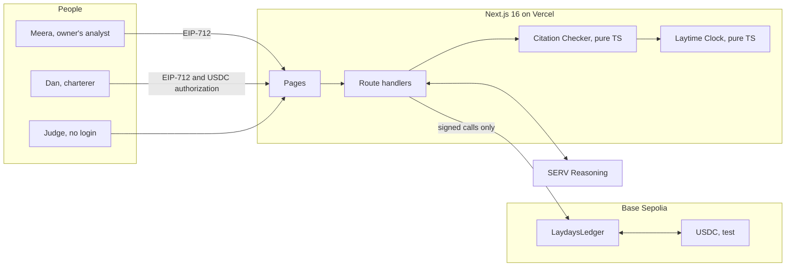

# Architecture

## Shape

One Next.js 16 app on Vercel. No database and no blob store. State lives in three places: the chain (claim stage, money, signatures), the recorded run files in the repository (rulings, proof), and the URL (the owner's signature travels to the charterer in a link).

## Who can move money

Only the parties' own signatures. The ledger verifies every signature with `SignatureChecker` (so smart wallets work too), uses a per-signer nonce, and every signature carries a deadline. The relayer is a capped testnet account that pays gas: the relay route decodes the call, refuses any function outside the six the ledger exposes, simulates it first and returns the decoded revert instead of sending it. Every page that relays also offers "Send it from my wallet", so the product works with the server gone.

## The ledger

`present` refuses after `completionOfDischarge + timeBarDays` and refuses when `requiredDocsMask & ~providedDocsMask` is not zero. `fundWithAuthorization` pulls USDC with an EIP-3009 `receiveWithAuthorization` signed by the charterer. `answer` pays the accepted amount to the owner at once. `settle` needs both signatures. `reclaim` returns what is still held to the charterer if nobody acts for 30 days.

## The ruling run

1. Port Clerk (`gpt-6-luna`, Prompt Guard, strict schema): numbered log to typed events. If Prompt Guard refuses the log, each line is tried alone, refused lines are set aside and shown, and the rest are read.
2. Code builds intervals between consecutive state-changing events, from laytime commencement to completion of discharge, taking the log text from the original log and never from model output.
3. Clause Reader (`gpt-6-luna-serv-kronos-multipath`, Shadow Agent hint, strict schema): seven intervals per request, in parallel, so no serverless call approaches its time limit.
4. Citation Checker: clause ids exist in the right rulebook, log lines exist, the starting line is cited, the reason is usable, a recorded cause (rain, strike, shore equipment, shifting, port closure) has its clause considered, and the model's effect equals the one code resolves.
5. Precedence is decided in code ([`precedence.ts`](lib/laytime/precedence.ts)): charter party over definitions, port rules for closures and holidays, a real conflict between charter party and port rules goes to a person.
6. Senior Reader (`gpt-6.1-sol-serv-multipath`) re-rules ambiguous intervals once.
7. Laytime Clock: integer minutes, half minutes internally so a half-rate interval counts exactly half, money in integer cents rounded half up once on the total.

## Why the system prompt is stable

Multipath compiles and stores one reasoning graph per exact source prompt. The system prompt holds only the branch structure, our own laytime definitions, the house rules and the output contract. Each voyage's clauses go in the user message as numbered data. The SHA-256 of the system prompt is the rulebook version shown on every ruling.

## Testnet scale

One cent of demurrage is one millionth of a USDC on the ledger, so the demo claim of $41,750.00 is 4.175 USDC and the faucet's 20 USDC covers the whole walkthrough. Every screen that shows an amount in USDC says so.
