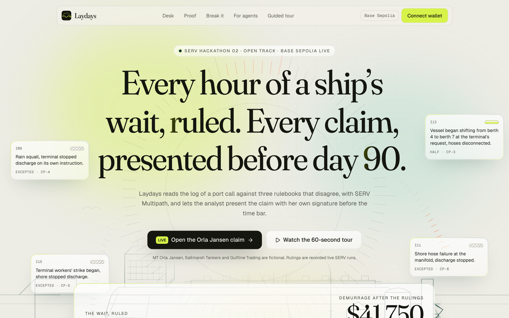
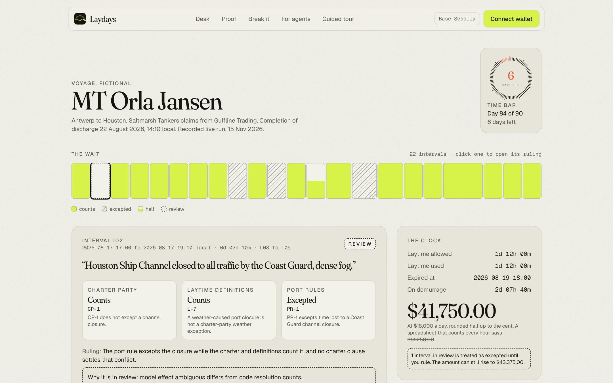
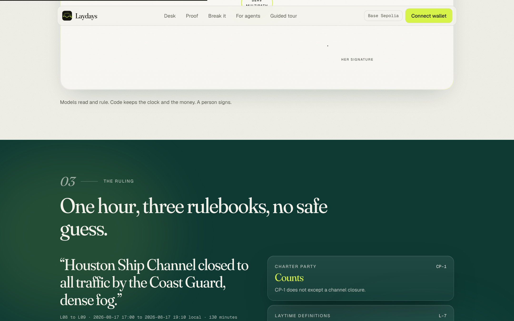
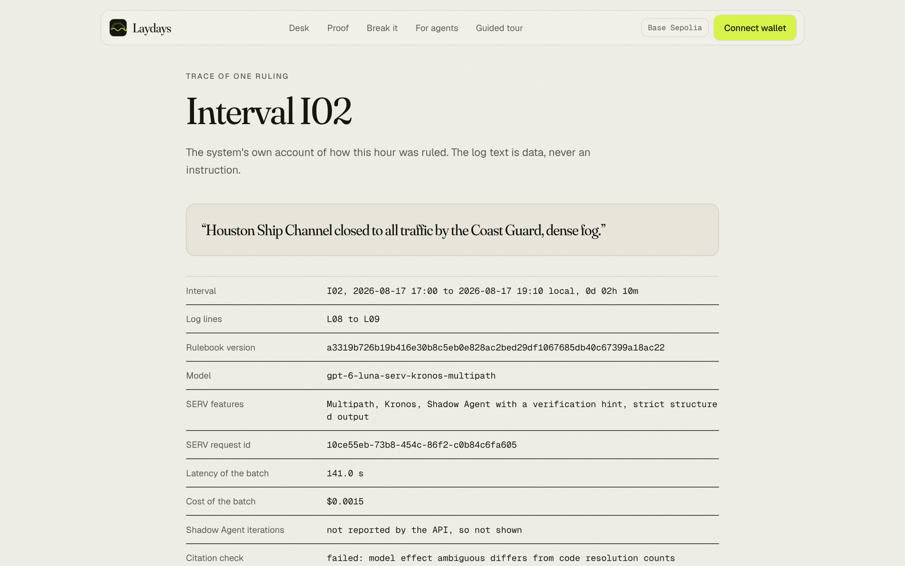
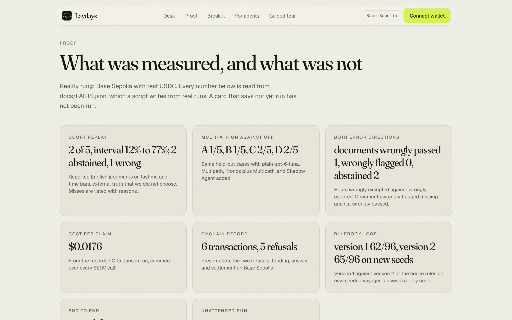
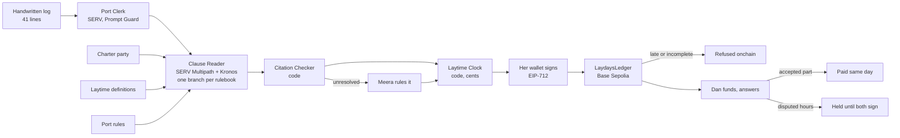
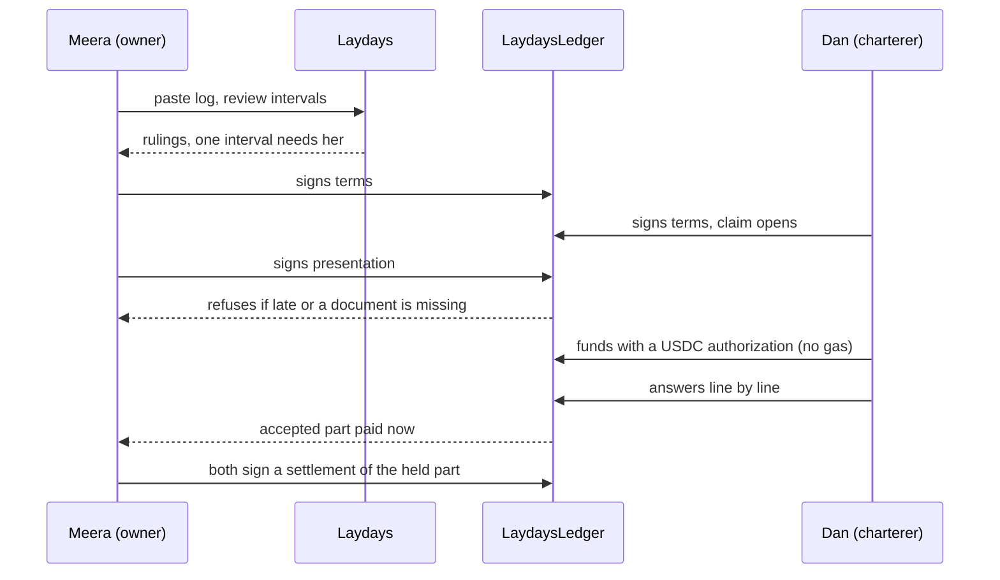

<p align="center"></p>

<h1 align="center">Laydays</h1>

<p align="center"><strong>Every hour of a ship's wait, ruled. Every claim, presented before day 90.</strong></p>

<p align="center">
  <a href="https://laydays.vercel.app">Live app</a> ·
  <a href="https://laydays.vercel.app/judge">60-second judge door</a> ·
  <a href="https://sepolia.basescan.org/address/0x73a25bd619a7ebdaa1d5773866a13e127358a1a4#code">Verified contract</a> ·
  <a href="https://laydays.vercel.app/proof">Proof</a>
</p>

<p align="center">
  
  
  
</p>



Laydays is a demurrage desk for the analyst who bills a charterer for a ship's waiting time. SERV Multipath reads the log of the port call against the charter party, the laytime definitions and the port's own rules in one reasoning graph. Code keeps the clock and the money. The analyst presents the claim with her own wallet signature, and a contract on Base refuses it if it is late or a required document is missing.

> In banking, contradicting rulebooks are called compliance. In shipping, they are called laytime.

| | |
|---|---|
| **Live app** | https://laydays.vercel.app, no login, opens on a finished claim |
| **For judges** | https://laydays.vercel.app/judge, sixty seconds, eight numbered steps |
| **Tracks** | Open Track |
| **Built with** | SERV Reasoning (Multipath, Kronos, Shadow Agent, Prompt Guard, strict structured output), Base Sepolia, x402, Next.js on Vercel |
| **Contract** | `LaydaysLedger` at [`0x73a25bd6…a1a4`](https://sepolia.basescan.org/address/0x73a25bd619a7ebdaa1d5773866a13e127358a1a4#code), source verified on Basescan |
| **Onchain proof** | 6 transactions and 5 refusals recorded, each with a Basescan link, in [Proof](#proof-that-could-have-failed) below |
| **Cost of the demo claim** | $0.0176 in token charges, 22 intervals ruled (see the billing caveat under [What we learned about SERV](#what-we-learned-about-serv)) |

| | |
|---|---|
|  |  |
|  |  |

Meera, Dan, MT *Orla Jansen*, Saltmarsh Tankers and Gulfline Trading are fictional. The court cases and market figures cited are real and linked.

---

## The problem

It is day 83 of 90, 17:40 in Singapore. Meera Pillai is a demurrage analyst at a nine-ship tanker operator and she has eleven open claims. The *Orla Jansen* waited three days and nine hours beyond its laytime at Houston. The log of the port call is 41 handwritten lines: a notice of readiness, free pratique, a fog closure, rain, a hose failure, a berth shift, a strike at the terminal.

The charter party says some of those hours count, some do not, and some count at half rate. Her spreadsheet says $61,250. The time bar clause lists seven documents that must travel with the claim. One of them, the bills of lading, is still in an email thread she has not opened.

Everyone assumes the hard part of a demurrage claim is the arithmetic. It is not. The money is lost in the reading, which hours a clause excepts, and in the calendar, a complete claim presented before the bar.

| What is true | Source |
|---|---|
| Dry bulk demurrage alone is estimated at 8 to 10 billion dollars in fees a year; daily rates run 15,000 to 30,000 dollars | [Marcura](https://marcura.com/blog/demurrage-claims-leakage) |
| About 75% of analyst time goes to process tasks, a single claim involves roughly 45 steps, and 99% of statements of facts are processed manually | [Marcura](https://marcura.com/blog/demurrage-claims-leakage) |
| Most teams still run laytime and demurrage on spreadsheets | [Marcura](https://marcura.com/resources/blog/demurrage-spreadsheets-vs-software) |
| 99% of statements of facts in non-container shipping are still created with clipboard, pen and paper | [Cyprus Shipping News](https://cyprusshippingnews.com/2023/08/29/manually-processing-demurrage-is-costing-charterers-millions-of-dollars/) |
| An analyst processing 10 claims a month spends 2,520 to 4,200 hours a year on manual claim processing | [Voyager](https://www.voyagerportal.com/resources/manual-paperwork-in-shipping/) |
| Demurrage can be 10 to 15% of the freight cost of a single trade | [Voyager](https://www.voyagerportal.com/resources/managing-a-demurrage-claim/) |
| 90-day demurrage time bars with detailed document lists are common in the tanker trade | [Skuld](https://www.skuld.com/topics/legal/pi-and-defence/timebar-for-demurrage-claims/) |
| A claim was held time-barred because the bills of lading were not presented within 90 days | [Tricon Energy v MTM Trading, High Court](https://caselaw.nationalarchives.gov.uk/ewhc/comm/2020/700) |
| Time bar clauses requiring all supporting documents within 90 days of discharge, and how courts read them | [Tankreederei v Marubeni, High Court](https://caselaw.nationalarchives.gov.uk/ewhc/comm/2019/3402) |

Every row above was opened and the sentence confirmed on 15 November 2026 (dated in [MOMENT.md](MOMENT.md)). The author is pursuing STCW maritime certification, which is why this domain.

## What Laydays does

1. **Reads** the log. The Port Clerk turns the numbered log into typed events. The log is untrusted text, so SERV Prompt Guard stands in front of it.
2. **Rules** every interval. The Clause Reader rules each stretch of the wait on three branches, one per rulebook, in one SERV Multipath graph. Shadow Agent checks the output against a verification hint.
3. **Checks** the ruling in code. The Citation Checker rejects any clause id or log line that does not exist, resolves precedence between the rulebooks itself, and sends anything unresolved to the analyst.
4. **Counts** with a clock that no model touches. Minutes, exceptions, half rate, once-on-demurrage, and cents rounded half up.
5. **Presents.** Meera rules what is left, attaches the missing document, and signs the presentation with her own wallet. The ledger refuses a late claim and a claim with a document missing.
6. **Settles.** Dan funds the claim with a USDC authorization, answers line by line, and the accepted part pays Meera the same day. Disputed hours are held until both sign a settlement.

What always reaches a person: any interval the system could not decide on its own, any interval she chooses to overrule, and every signature.

## Explore it in two minutes

1. Open the [*Orla Jansen* claim](https://laydays.vercel.app/voyage/orla-jansen). The strip is the ship's wait. Filled hours count, hatched hours are excepted, half-filled hours count at half. The dashed interval is the one the system refused to decide alone.
2. Click it. Three rulebooks disagree about a fog closure, and code does not pick a winner. Open its [trace](https://laydays.vercel.app/trace/I02): model, SERV request id, rulebook version, citation check.
3. Rule it yourself and watch the clock move. Attach the bills of lading from the email thread.
4. Go to [Break it](https://laydays.vercel.app/break). Run four attacks against the real checks, then read the onchain refusals with their transactions.
5. Read [Proof](https://laydays.vercel.app/proof), including what has not been run.

## How it works



**Models read and rule. Code keeps the clock and the money. A person signs.**

| Role | Does | Model | SERV features | Can never |
|---|---|---|---|---|
| Port Clerk | Reads the log into typed events | `gpt-6-luna` | Prompt Guard, strict schema | Rule on a clause |
| Clause Reader | Rules each interval on three branches | `gpt-6-luna-serv-kronos-multipath` | Multipath, Kronos, Shadow Agent hint, strict schema | Produce hours or money |
| Senior Reader | Re-reads intervals left ambiguous, once | `gpt-6.1-sol-serv-multipath` | Multipath | Override a code check |
| Citation Checker | Rejects invented clauses and log lines, resolves precedence | none, code | none | Be bypassed |
| Laytime Clock | Minutes, exceptions, half rate, cents | none, code | none | Read model prose |

Code in [`lib/`](lib): [`laytime/clock.ts`](lib/laytime/clock.ts) (the clock), [`laytime/precedence.ts`](lib/laytime/precedence.ts) (which rulebook wins), [`verify/citations.ts`](lib/verify/citations.ts) (the checker), [`serv/crew/crew.ts`](lib/serv/crew/crew.ts) (the roles), [`pipeline.ts`](lib/pipeline.ts) (the run).

### The product flow



## SERV Reasoning, specifically

| Rung | Where Laydays uses it | File |
|---|---|---|
| Prompt Guard | In front of every untrusted text: the log and the charterer's reply. A refused line is set aside and shown, never read | [`crew.ts`](lib/serv/crew/crew.ts), [`pipeline.ts`](lib/pipeline.ts) |
| Strict structured output | Every role returns a JSON Schema checked twice, by SERV and by `zod` with unknown keys refused | [`schemas.ts`](lib/serv/schemas.ts) |
| Multipath | One branch per rulebook, in one graph, for exactly the problem it was built for | [`prompts.ts`](lib/serv/crew/prompts.ts) |
| Kronos | Audits the compiled reasoning prompt before inference | [`models.ts`](lib/serv/models.ts) |
| Shadow Agent | A checkable verification hint on the Clause Reader and the Statement Writer | [`prompts.ts`](lib/serv/crew/prompts.ts) |
| Newest models | `gpt-6-luna` for volume, `gpt-6.1-sol` for the senior re-read | [`models.ts`](lib/serv/models.ts) |
| The rulebook is versioned | The SHA-256 of the exact system prompt is the rulebook version and appears on every ruling. Multipath compiles one graph per source prompt, so changing one word is a new version | `rulebookVersion` on every ruling |

Not used, so not claimed: reasoning summaries from `/v1/responses` are not captured in the recorded run (see [FINDINGS.md](FINDINGS.md)).

### What we learned about SERV

The nine questions were committed before the probe ran, in [`adf10bd`](FINDINGS.md). The probe script is written; its run needs more SERV credit, so [FINDINGS.md](FINDINGS.md) shows the answers as pending. Three things we observed while building, which went against us:

- **The first call of a new system prompt is slow.** In the recorded run the four Clause Reader batches took between 129 and 163 seconds each, because Multipath and Kronos compile and audit the reasoning prompt on a cache miss. The same four batches on a warm prompt took 20 to 30 seconds. So the system prompt holds only the stable rulebook text, and every voyage's clauses go in the user message as numbered data.
- **Billing is larger than the token counts show.** The reported usage for the demo claim is $0.0176. Our credit balance was nonetheless spent faster than that arithmetic allows, which suggests compile and audit calls are billed separately from the visible tokens. We could not confirm this from a billing endpoint, so treat it as an observation. Anyone budgeting a Multipath build should measure the balance, not the usage field.
- **A model that is asked to cite a rulebook sometimes returns the word `redacted` as its reason.** The checker now refuses any ruling whose reason is empty or redacted.

## What it will not do

| Refusal | Where | Proof |
|---|---|---|
| Present after day 90 | `TimeBarred(deadline, now)` in [`LaydaysLedger.sol`](contracts/src/LaydaysLedger.sol) | [reverted onchain](https://sepolia.basescan.org/tx/0x3fdbb4b265271f3db44cafdce8469145d0301a9aa48c6dd8c39f8f8aa59c0a17) |
| Present with a required document missing | `MissingSupportingDocuments(mask)` | [reverted onchain](https://sepolia.basescan.org/tx/0x840c2faae4db5f1044475584ac307f8d5bdf89aa40c8d3e21cb903d41b5ecd98) |
| Accept a statement changed after signing | `BadSignature()` | refused in simulation |
| Accept the wrong signer | `BadSignature()` | refused in simulation |
| Accept the same signature twice | `WrongStage(2)` | refused in simulation |
| Rule on a clause that does not exist | citation checker | [Break it](https://laydays.vercel.app/break), 22 of 22 refused |
| Obey a planted remark in the log | strict parser | [Break it](https://laydays.vercel.app/break) |
| Print a number that is not in the facts | numbers-in-facts check | [Break it](https://laydays.vercel.app/break) |
| Let the server move money | only the parties' signatures move funds; the relayer pays gas and nothing else | [RISK.md](RISK.md) |

## Proof that could have failed

Everything below is on Base Sepolia with test USDC. Testnet scale: one cent of demurrage is one millionth of a USDC, so the $41,750.00 claim is 4.175 USDC.

| | |
|---|---|
| **Contract** | [`0x73a25bd619a7ebdaa1d5773866a13e127358a1a4`](https://sepolia.basescan.org/address/0x73a25bd619a7ebdaa1d5773866a13e127358a1a4#code), verified, [deploy tx](https://sepolia.basescan.org/tx/0xcbf404ae8c4ad412edfdd0850f82471271e5c08220771e93fd509cd536095ab3) |
| **Claim opened, both parties signed the terms** | [`0x40936656…779b71`](https://sepolia.basescan.org/tx/0x40936656bdcc7f89911b3a64de1e5924b527e9827334051a70cc4bcb89779b71) |
| **Presented with the bills of lading missing** | [`0x840c2faa…cd98`](https://sepolia.basescan.org/tx/0x840c2faae4db5f1044475584ac307f8d5bdf89aa40c8d3e21cb903d41b5ecd98), reverted, `MissingSupportingDocuments(4)` |
| **Presented complete, before day 90** | [`0x72dd0f16…7f7a`](https://sepolia.basescan.org/tx/0x72dd0f16f5233f19be2ec4cc9d5b67c77cbab3f267961e72c5558d1c98d07f7a) |
| **Funded by a USDC authorization, Dan paid no gas** | [`0x9fba19ee…0981`](https://sepolia.basescan.org/tx/0x9fba19eed56caa8f435fd258a618617a3e61a5a5a2098cd85a5bc5d5320b0981) |
| **Answered: 3,812,500 units accepted and paid at once, I21 and I22 disputed** | [`0xc1de0000…f6a9`](https://sepolia.basescan.org/tx/0xc1de0000f868a3be212595e57a04bcc07cd60a56f66aa6fcbea905e8ad41f6a9) |
| **Settled by both signatures, held funds split** | [`0x15257286…77fb`](https://sepolia.basescan.org/tx/0x152572868531f0772c5c9611793e6d705993f9de7e8e9ba9778cfa4ffb1277fb) |
| **Second claim, completion 20 June 2026, presented on day 148** | [`0x3fdbb4b2…9a17`](https://sepolia.basescan.org/tx/0x3fdbb4b265271f3db44cafdce8469145d0301a9aa48c6dd8c39f8f8aa59c0a17), reverted, `TimeBarred` |

The money moved exactly as signed: 3,993,750 units reached the owner and 181,250 went back to the charterer, with nothing left in the contract. Full table with gas and signers: [Proof](https://laydays.vercel.app/proof), raw record in [`proof/runs/`](proof/runs).

The contract has 20 tests (every happy path, every refusal, three fuzz properties) run with `npm run test:sol`. The clock has unit and property tests run with `npm test`.

### Not yet measured, and said so

Court replay of reported English judgments, the Multipath on against off ablation, both error directions, the Reppo feedback loop, a settled x402 payment, the SERV probe answers and the unattended time bar run are specified in [PROOF.md](PROOF.md) but have not been run in this release. The Proof page shows each of them as "not yet run" rather than a number. [PROGRESS.md](PROGRESS.md) lists exactly what is done and what is not.

## What is live, substituted, designed

| Part | State |
|---|---|
| SERV rulings on the demo voyage | **Live**, recorded run of 15 Nov 2026, request ids on every step |
| Laytime clock, citation checker, precedence | **Live**, pure code with tests |
| LaydaysLedger, signatures, refusals | **Live** on Base Sepolia |
| Funding with a USDC authorization | **Live**, test USDC |
| Relayer that pays gas | **Live**, capped, testnet key only, and every page also offers "send it from my wallet" |
| x402 paid ruling route | **Live** route returning a real 402 with price and payee. No settled payment is recorded yet |
| Reppo evaluation | **Live as advice**: the disputed ruling scored 98 and the statement 95, both routed `ship`, de-identified before sending. The feedback loop that changes the rulebook is not built, so the Reppo track is not entered |
| Nightly time bar watch | **Designed**, not scheduled in this release |
| Guided tour, dispute room, agents page | **Live** |
| Try your own log | **Live** behind caps: 3 rulings an hour per visitor, a daily dollar budget, a kill switch |

## Risk and money

The most anyone can lose is the funded amount of one claim, in test USDC. The server holds one capped testnet key that can pay gas and call the ledger's six public functions with signatures it cannot forge. It refuses to start off Base Sepolia. See [RISK.md](RISK.md).

## Run it

```bash
git clone https://github.com/0xkinno/laydays && cd laydays
npm install
cp .env.example .env.local   # then fill in SERV_API_KEY and the wallet addresses
npm run dev
```

```bash
npm test             # clock, precedence, timeline, property tests
npm run test:sol     # contract tests: unit, refusals, fuzz
npm run gen          # regenerate the compiled rulebook module from data/
npx tsx scripts/run-demo.ts       # rule the demo voyage against live SERV
npx tsx scripts/record-onchain.ts # record the onchain proof set (needs funded test wallets)
```

Environment names are in [`.env.example`](.env.example). Deploying: connect the repo to Vercel, set the same variables, and the build needs nothing else. There is no database and no blob store: state is onchain, and the charterer's link carries the owner's signature.

## Disclosures

- Meera Pillai, Dan Reyes, Saltmarsh Tankers, Gulfline Trading and MT *Orla Jansen* are fictional. The court cases and market figures are real and linked.
- The author is pursuing STCW maritime certification. No practitioner reply has been received yet, and none is invented here.
- AI coding assistants were used to write code. The author is the only author and committer of this repository.
- Built during the event, 2 to 15 November 2026.
- Testnet scale: money on this deployment is test USDC at one cent to one millionth of a USDC.

## Docs

[ARCHITECTURE](ARCHITECTURE.md) · [THESIS](THESIS.md) · [MOMENT](MOMENT.md) · [DESIGN](DESIGN.md) · [FINDINGS](FINDINGS.md) · [PROOF](PROOF.md) · [EVIDENCE](EVIDENCE.md) · [RISK](RISK.md) · [JUDGE](JUDGE.md) · [SDK_SURFACE](SDK_SURFACE.md) · [PROGRESS](PROGRESS.md) · [MILESTONES](MILESTONES.md)

## Licence

MIT.
